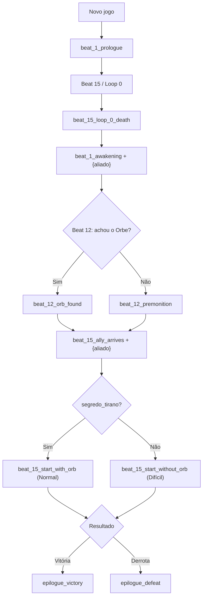

# Relatório — Cutscenes Estáticas (`game_cutscenes.json`)

**Equipe:** Dev IA (Narrativa e Prompts) + Dev Backend (Estrutura de JSON)
**Arquivo gerado:** [game_cutscenes.json](file:///c:/Users/iagob/RPGMesaPY/game_cutscenes.json), em JSON puro, UTF-8 e sem Markdown.

---

## 1. Validação automática

O arquivo passou por um script de validação: `json.load` com `encoding="utf-8"`, checagem de cada caixa antes e depois do `.format()`, e uso do `string.Formatter` para detectar placeholders inválidos. Para testar o pior caso, o `{aliado}` foi substituído por um nome longo (`"Bjorn, o Mercenário"`, com 19 caracteres).

| Chave | Caixas | Maior caixa (já formatada) | Usos de `{aliado}` |
|---|---|---|---|
| `beat_1_prologue` | 8 | 161 | 0 |
| `beat_15_loop_0_death` | 11 | 174 | 0 |
| `beat_1_awakening` | 12 | 166 | 5 |
| `beat_12_orb_found` | 7 | 154 | 0 |
| `beat_12_premonition` | 6 | 159 | 0 |
| `beat_15_ally_arrives` | 10 | 175 | 5 |
| `beat_15_start_with_orb` | 6 | 141 | 0 |
| `beat_15_start_without_orb` | 6 | 155 | 0 |
| `epilogue_victory` | 10 | 152 | 0 |
| `epilogue_defeat` | 8 | 132 | 0 |
| **Total** | **84** | **175 (máx.)** | **10** |

**Resultado:** nenhum erro. Todas as caixas ficam abaixo de 200 caracteres, com folga mínima de 25. O único placeholder presente é `{aliado}`.

---

## 2. Decisões narrativas

- **Fio condutor sensorial:** "gosto de cinzas e carne queimada" aparece na morte, no despertar e na premonição. Isso costura o Déjà Vu ao corpo do jogador: ele acorda com a pele intacta, mas o corpo se lembra.
- **O Orbe é trancado pelo loop:** a inscrição do altar diz *"SÓ O TOQUE DE QUEM JÁ ARDEU PODE DESPERTÁ-LO"*. Isso explica dentro da história por que o segredo só existe a partir do Loop 1.
- **Semente do aliado:** no despertar, `{aliado}` fala sobre as *"Cinzas que voltam"*, uma lenda de família. Isso prepara a chegada da relíquia familiar (a **Égide dos Antigos**) no Beat 15, então a ajuda surpresa não parece um *deus ex machina*.
- **Mensagens de sistema:** foi seguido o padrão `[SISTEMA]` que o log da engine já usa. O "999 de dano absoluto" aparece numa caixa própria, para não quebrar a prosa.
- **Neutralidade de gênero:** nenhum adjetivo flexionado se refere ao jogador ou ao `{aliado}` (por exemplo, "ainda respira" em vez de "vivo/viva"). O texto funciona com qualquer personagem ou NPC.
- **Sem início de frase com `{aliado}` quando dava para evitar:** isso protege contra nomes em minúscula. Mesmo assim, veja a regra 3.2.

---

## 3. Guia de integração (Backend)

### 3.1 Carregamento seguro
```python
import json

with open("game_cutscenes.json", "r", encoding="utf-8") as f:
    CUTSCENES = json.load(f)

def get_cutscene(key: str, aliado: str | None = None) -> list[str]:
    boxes = CUTSCENES.get(key, [])
    if aliado is None:
        return list(boxes)
    return [b.format(aliado=aliado) for b in boxes]
```

### 3.2 Regras do placeholder
1. Só `beat_1_awakening` e `beat_15_ally_arrives` usam `{aliado}`. As demais chaves podem ser exibidas sem `.format()`.
2. Passe o **nome próprio já capitalizado** do NPC (ex.: `"Bjorn"`), sem artigo.
3. Mantenha o nome do NPC com **no máximo cerca de 25 caracteres** para preservar o limite de 200 por caixa.
4. Nunca use chaves `{ }` soltas em textos futuros deste arquivo, porque o `.format()` quebraria.

### 3.3 Fluxo sugerido de gatilhos


---

## 4. Pendências e conflitos que exigem decisão

> [!WARNING]
> **Conflito com a correção do Bloco 37:** a engine atual aciona **Déjà Vu infinito** em qualquer morte no Beat 15. Já a chave `epilogue_defeat` descreve um **Game Over definitivo no Loop 1** ("desta vez o tempo não volta"). É preciso escolher uma das opções:
> - (a) Mudar a engine para Game Over no Loop ≥ 1; ou
> - (b) Usar `epilogue_defeat` só a partir de um limite de loops (ex.: Loop ≥ 3).

> [!IMPORTANT]
> **Égide dos Antigos sem mecânica:** a última caixa de `beat_15_ally_arrives` promete *"o grupo inteiro resiste ao fogo"*. Isso ainda **não existe** no `combat_system.py`. Sugestão para o Dev Backend: reduzir pela metade o dano de fogo do Boss enquanto o aliado estiver vivo, ou por N turnos. A outra saída é remover essa linha de `[SISTEMA]`.

- **Recrutamento do `{aliado}`:** a caixa `[SISTEMA] {aliado} entrou para o grupo` supõe que a engine injeta esse NPC na party ao abrir a cutscene.
- **Local do arquivo:** ele foi salvo na **raiz** do projeto, como pedido. Para manter o padrão, considere movê-lo para `data/game_cutscenes.json`, junto de `campaign.json` e `bestiary.json`.
- **Retratos:** se a UI usar `npc_falando`, as falas de `{aliado}` e do taverneiro no prólogo são boas candidatas a exibir retrato.
