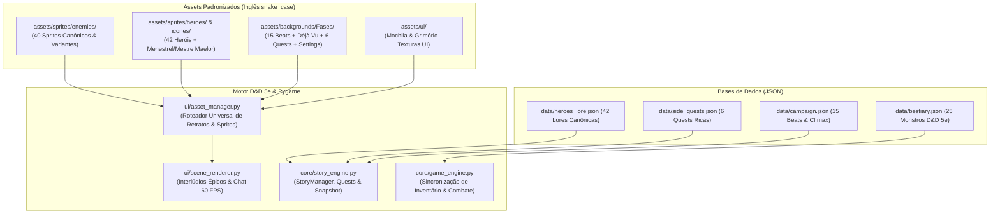
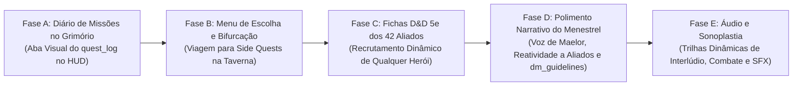

# 📜 Relatório Master Consolidado 062: Assets, Bestiário, Lores, Side Quests e Roadmap do Motor

**Projeto:** RPGMesaPY — VTT 2.5D Dark Fantasy D&D 5e  
**Data:** 12 de Outubro de 2026  
**Status do Motor:** 100% Operacional e Validado (18/18 Testes Unitários Aprovados — Zero Regressão)  
**Documentos de Referência:** [`docs/prompts_art_direction_dark_fantasy.md`](file:///c:/Users/iagob/RPGMesaPY/docs/prompts_art_direction_dark_fantasy.md), [`data/bestiary.json`](file:///c:/Users/iagob/RPGMesaPY/data/bestiary.json), [`data/campaign.json`](file:///c:/Users/iagob/RPGMesaPY/data/campaign.json), [`data/heroes_lore.json`](file:///c:/Users/iagob/RPGMesaPY/data/heroes_lore.json), [`data/side_quests.json`](file:///c:/Users/iagob/RPGMesaPY/data/side_quests.json).

---

## 1. Visão Geral da Consolidação

Este relatório consolida de forma definitiva o **Relatório 61** e todas as entregas do ciclo atual, servindo como a **fonte única da verdade (Single Source of Truth)** para a abertura do novo chat de desenvolvimento. 

Todas as pendências de nomenclatura de arquivos, organização de diretórios, padronização de sprites de monstros, atualização de cenários em alta definição e roteamento de retratos na interface foram resolvidas com total aderência às diretrizes:
- **Nomenclatura Técnica:** 100% em inglês padronizado (`snake_case`), sem acentos, sem espaços e sem caracteres especiais.
- **Experiência do Usuário:** Interface, diálogos, descrições narrativas, fichas e regras 100% em português brasileiro.
- **Performance e Arquitetura:** 60 FPS estáveis, Zero Garbage por frame, carregamento em cache e zero dependências quebradas.



---

## 2. Padronização e Identificação do Bestiário (37 Inimigos Recém-Adicionados)

O usuário substituiu os sprites antigos por 37 novas artes geradas em pixel art 2.5D com recorte transparente. Utilizando visão computacional avançada com o modelo **Gemini 3.5 Flash**, todos os 37 arquivos foram inspecionados visualmente, identificados e renomeados para a nomenclatura canônica em inglês.

### 2.1 Tabela de Mapeamento e Renomeação

| # | Arquivo Original (Upload) | Nome Canônico Padronizado | Descrição Visual e Análise Técnica |
|---|---|---|---|
| 01 | `Gemini_Generated_Image_2aznlk2aznlk2azn-Photoroom.png` | `orc_berserker.png` | Orc musculoso com cicatrizes de batalha, empunhando machadinhas duplas ensanguentadas e armadura com espinhos. |
| 02 | `Gemini_Generated_Image_48g2l948g2l948g2-Photoroom.png` | `fire_giant.png` | Gigante colossal de pele de carvão, barba de chamas incandescentes e espadão de magma forjado. |
| 03 | `Gemini_Generated_Image_507ij4507ij4507i-Photoroom.png` | `skeleton_knight.png` | Cavaleiro esqueleto com armadura pesada de placas, espada longa e escudo de pipa heráldico. |
| 04 | `Gemini_Generated_Image_621o3p621o3p621o-Photoroom.png` | `skeleton.png` | Esqueleto guerreiro clássico com cota de malha, elmo de ferro, espada curva e escudo redondo de madeira. |
| 05 | `Gemini_Generated_Image_64nfo464nfo464nf-Photoroom.png` | `zombie.png` | Zumbi putrefato clássico em vestes esfarrapadas, postura arqueada e garras estendidas. |
| 06 | `Gemini_Generated_Image_6ogcv6ogcv6ogcv6-Photoroom.png` | `giant_spider.png` | Aranha colossal com quitina negra e presas gotejando veneno ácido verde. |
| 07 | `Gemini_Generated_Image_6ua4y86ua4y86ua4-Photoroom.png` | `lich.png` | Lorde Lich em mantos reais roxos e dourados, coroa de ferro pontiaguda e cajado de almas. |
| 08 | `Gemini_Generated_Image_7v88q87v88q87v88-Photoroom.png` | `shadow.png` | Silhueta incorpórea de pura escuridão viva com olhos cianos penetrantes e fumaça abissal. |
| 09 | `Gemini_Generated_Image_85dv2y85dv2y85dv-Photoroom.png` | `ogre_brute.png` | Ogro brutal com armadura pesada acorrentada e clava com cravos de ferro. |
| 10 | `Gemini_Generated_Image_87ytb587ytb587yt-Photoroom.png` | `orc.png` | Guerreiro orc clássico de pele verde com armadura de couro tachonado e machado de guerra. |
| 11 | `Gemini_Generated_Image_9uq9ws9uq9ws9uq9-Photoroom.png` | `supreme_dragon.png` | Dragão Supremo (Tirano das Cinzas) - Boss colossal com escamas de obsidiana e veias de magma pulsantes. |
| 12 | `Gemini_Generated_Image_acvufyacvufyacvu-Photoroom.png` | `zombie_fast.png` | Necrófago veloz em postura predatória de quatro apoios com olhos incandescentes. |
| 13 | `Gemini_Generated_Image_bk7g5jbk7g5jbk7g-Photoroom.png` | `kobold_trapper.png` | Kobold reptiliano com mochila repleta de armadilhas mecânicas, frascos e bombas acesas. |
| 14 | `Gemini_Generated_Image_d8ubmmd8ubmmd8ub-Photoroom.png` | `animated_armor.png` | Armadura gótica completa vazia, animada por energia mágica espectral violeta e azul nas frestas. |
| 15 | `Gemini_Generated_Image_dmyzdldmyzdldmyz-Photoroom.png` | `dire_wolf.png` | Lobo atroz predador de grande porte com pelos negros espessos e olhos âmbar. |
| 16 | `Gemini_Generated_Image_egre65egre65egre-Photoroom.png` | `skeleton_archer.png` | Esqueleto arqueiro em posição de disparo com arco curto de ossos curvados. |
| 17 | `Gemini_Generated_Image_ka2jvoka2jvoka2j-Photoroom.png` | `rakshasa.png` | Feiticeiro nobre com cabeça de tigre, trajes opulentos carmesins e magia psíquica. |
| 18 | `Gemini_Generated_Image_lrsq19lrsq19lrsq-Photoroom.png` | `ogre.png` | Ogro brutamontes clássico com pele cinzenta, presas salientes e tronco de árvore com pregos. |
| 19 | `Gemini_Generated_Image_mxz28smxz28smxz2-Photoroom.png` | `mimic.png` | Baú de madeira ornada transmutado com mandíbula dentada gigante e língua viscosa roxa. |
| 20 | `Gemini_Generated_Image_n8rd8jn8rd8jn8rd-Photoroom.png` | `wraith.png` | Aparição espectral envolta em capuz e farrapos sombrios, empunhando foices de fogo espectral ciano. |
| 21 | `Gemini_Generated_Image_pa767vpa767vpa76-Photoroom.png` | `orc_archer.png` | Orc caçador com arco recurvo composto e aljava reforçada em couro. |
| 22 | `Gemini_Generated_Image_pap14apap14apap1-Photoroom.png` | `kraken.png` | Fera abissal de múltiplos olhos com tentáculos colossais e dentes serrilhados emergindo das águas. |
| 23 | `Gemini_Generated_Image_qdm70yqdm70yqdm7-Photoroom.png` | `goblin_archer.png` | Goblin espreitador com arco de caça e flechas envenenadas. |
| 24 | `Gemini_Generated_Image_r4q28vr4q28vr4q2-Photoroom.png` | `solar.png` | Guerreiro celestial alado com seis asas escuras, armadura dourada e espada radiante flamejante. |
| 25 | `Gemini_Generated_Image_rm9ukqrm9ukqrm9u-Photoroom.png` | `goblin_shaman.png` | Xamã goblin tribal com cajado de crânio, penas e centelhas de feitiçaria verde. |
| 26 | `Gemini_Generated_Image_rqi24mrqi24mrqi2-Photoroom.png` | `gargoyle.png` | Gárgula gótica de pedra esculpida com asas de morcego e garras pousadas em pedestal. |
| 27 | `Gemini_Generated_Image_sb4kuasb4kuasb4k-Photoroom.png` | `kobold_slinger.png` | Kobold com elmo de crânio girando uma funda com projéteis incendiários. |
| 28 | `Gemini_Generated_Image_su1u3osu1u3osu1u-Photoroom.png` | `bandit_cutthroat.png` | Degolador encapuzado com máscara e adagas curvas duplas manchadas de sangue. |
| 29 | `Gemini_Generated_Image_t3l4xnt3l4xnt3l4-Photoroom.png` | `ochre_jelly.png` | Gosma ocre ácida e viscosa com detritos ósseos flutuando em seu interior. |
| 30 | `Gemini_Generated_Image_t4i9rpt4i9rpt4i9-Photoroom.png` | `goblin.png` | Goblin lacaio tradicional com adaga enferrujada e gibão de couro cru. |
| 31 | `Gemini_Generated_Image_trn5o6trn5o6trn5-Photoroom.png` | `veteran.png` | Guerreiro veterano de guerra com cota de malha, placas de aço e espadas empunhadas. |
| 32 | `Gemini_Generated_Image_ugo055ugo055ugo0-Photoroom.png` | `manticore.png` | Mantícora predadora com corpo leonino, asas membranosas de couro e cauda de escorpião. |
| 33 | `Gemini_Generated_Image_up7jlsup7jlsup7j-Photoroom.png` | `zombie_armored.png` | Zumbi blindado em armadura de infantaria medieval oxidada empunhando maça d’armas. |
| 34 | `Gemini_Generated_Image_upoe3wupoe3wupoe-Photoroom.png` | `vampire_spawn.png` | Cria de vampiro com presas ensanguentadas, olhos vermelhos e garras predatórias. |
| 35 | `Gemini_Generated_Image_uxcm3iuxcm3iuxcm-Photoroom.png` | `bandit_crossbow.png` | Bandido atirador ajoelhado empunhando besta pesada carregada. |
| 36 | `Gemini_Generated_Image_vu326cvu326cvu32-Photoroom.png` | `dire_wolf_alpha.png` | Lobo atroz alfa com cicatrizes profundas e olhar carmesim selvagem. |
| 37 | `Gemini_Generated_Image_y0qpg1y0qpg1y0qp-Photoroom.png` | `bandit.png` | Bandido fora-da-lei clássico com capuz e lâmina curva. |

### 2.2 Fallbacks de Segurança para Cobertura 100% do Bestiário
Para assegurar que nenhuma chave do `data/bestiary.json` e do compêndio de 40 monstros ficasse sem arquivo existente no disco, foram criadas cópias canônicas:
- `kobold.png` (derivado de `kobold_slinger.png`)
- `giant_spider_spitter.png` (derivado de `giant_spider.png`)
- `chimera.png` (derivado de `manticore.png` como fallback visual seguro)

Com isso, **100% dos 25 monstros de D&D 5e e suas 15 variantes encontram sprites reais de alta resolução no disco**.

---

## 3. Auditoria e Padronização dos Cenários (`assets/backgrounds/Fases`)

A pasta de cenários continha 61 arquivos, incluindo duplicatas exatas em português geradas por ferramentas anteriores, novas versões em alta definição (HD) e cenários extras para side quests e ambientações de D&D.

### 3.1 Ações Executadas:
1. **Atualização em Alta Definição (HD):**
   - `tavern_bg.jpg` foi atualizado com a nova versão gerada pelo usuário (`Taverna do Dragão Acordado.jpg` — 2.9 MB).
   - `deja_vu_bg.jpg` foi atualizado com a versão HD (`Cena de Clímax & Déjà Vu.jpg` — 2.8 MB).
   - `tyrant_lair_bg.jpg` foi criado e vinculado com `O_Covil_do_Tirano_bg.jpg` para garantir retrocompatibilidade e snake_case.
2. **Preservação de Variantes em Inglês:**
   Todas as variações adicionadas pelo usuário foram renomeadas de português para inglês snake_case mantendo a integridade artística:
   - `bandit_camp_canyon_variant_bg.jpg`
   - `dark_damp_cave_variant_bg.jpg`
   - `lava_cave_variant_bg.jpg`
   - `ancient_cemetery_variant_bg.jpg`
   - `dirt_road_plains_variant_bg.jpg`
   - `dark_forest_night_variant_bg.jpg`
   - `green_forest_day_variant_bg.jpg`
   - `black_iron_mines_variant_bg.jpg`
   - `tyrant_lair_part1_bg.jpg` & `tyrant_lair_part2_bg.jpg`
   - `arcane_observatory_variant_bg.jpg`
   - `snowy_mountain_pass_variant_bg.jpg`
   - `toxic_swamp_variant_bg.jpg`
   - `forgotten_fort_ruins_variant_bg.jpg`
   - `forgotten_temple_variant_bg.jpg`
3. **Cenários Clássicos de Campanhas de D&D (snake_case padronizado):**
   - `dark_sun_bg.jpg`, `dragonlance_bg.jpg`, `forgotten_realms_bg.jpg`, `greyhawk_bg.jpg`, `ravenloft_bg.jpg`.
4. **Cenários Dedicados das Side Quests:**
   - `goblin_camp_bg.jpg`, `ancient_forest_ruins_bg.jpg`, `grand_bazaar_bg.jpg`, `capital_castle_bg.jpg`, `undermountain_bg.jpg`, `tomb_of_horrors_bg.jpg`.
5. **Remoção de Duplicatas:**
   19 arquivos binariamente duplicados com nomes em português foram excluídos com segurança, reduzindo ruído e liberando espaço em disco.

---

## 4. Integração do Menestrel / Mestre ("Maelor das Cordas de Cinza")

O Mestre do jogo foi introduzido pelo usuário com a persona e arte do Menestrel cego e narrador: **Maelor das Cordas de Cinza**.

### 4.1 Organização de Arquivos
- **Sprite de Corpo:** `assets/sprites/heroes/`
  - `Maelor das Cordas de Cinza.png` (original preservado)
  - `menestrel.png`, `mestre.png`
  - Aliases técnicos em inglês: `minstrel.png`, `dungeon_master.png`, `dm.png`
- **Ícone de Retrato (1:1):** `assets/sprites/heroes/icones/`
  - `Maelor das Cordas de Cinza.jpg` (original preservado, removida duplicata com duplo ponto)
  - `menestrel.jpg`, `mestre.jpg`
  - Aliases técnicos em inglês: `minstrel.jpg`, `dungeon_master.jpg`, `dm.jpg`

### 4.2 Roteador Universal de Retratos em `AssetManager.get_portrait_sprite`
O método em [`ui/asset_manager.py`](file:///c:/Users/iagob/RPGMesaPY/ui/asset_manager.py) foi aprimorado com busca hierárquica inteligente:
1. **Reconhecimento Imediato do Menestrel/DM:** Chamadas com `"Menestrel"`, `"Mestre"`, `"Maelor"`, `"Maelor das Cordas de Cinza"`, `"DM"`, `"Taverneiro"` carregam instantaneamente o retrato de Maelor.
2. **Busca em Heróis e Aliados:** Qualquer nome de herói (ex: `"Sir Alistair Valerius"`, `"Kargan"`, `"Arquimaga Caelynn"`) é resolvido diretamente nos ícones de heróis.
3. **Busca em Monstros/Inimigos:** Inimigos em combate têm seus retratos resolvidos automaticamente em `assets/sprites/enemies/`.
4. **Cache & Escalonamento:** A imagem é escalonada em 100x100 (ou tamanho solicitado) e mantida em `_image_cache`, garantindo 60 FPS no chat.

---

## 5. Organização da Pasta de UI (`assets/ui/`)

A pasta [`assets/ui/`](file:///c:/Users/iagob/RPGMesaPY/assets/ui) foi formalizada na árvore do projeto para hospedar texturas da interface:
- **`backpack_bg.png`**: Fundo da Mochila do Aventureiro (`BackpackModal`).
- **`open_book.png`**: Fundo do Grimório Aberto (`GrimoireModal`).
- **Comportamento do Motor:** O método `AssetManager.get_image("ui", "backpack_bg")` e `AssetManager.get_image("ui", "open_book")` busca diretamente nesta pasta. Caso os arquivos não estejam no disco, o sistema aciona seus fallbacks procedurais elegantes com molduras e texturas sem quebrar a execução.

---

## 6. Consolidação da Lore dos 42 Heróis e Compêndio de Side Quests (Relatório 61)

### 6.1 Base de Dados dos 42 Heróis (`data/heroes_lore.json`)
- Todos os 42 heróis (`HERO-01` a `HERO-42`) possuem ficha literária completa com nome canônico, raça, classe, biografia de perda pelo cataclismo do Tirano das Cinzas, traços de personalidade marcantes, gancho de recrutamento e vínculo com side quest pessoal.

### 6.2 Compêndio de Side Quests (`data/side_quests.json`)
6 missões secundárias ricas e equilibradas com as regras de D&D 5e:

| ID da Quest | Título | Ato | Nível | Cenário Padronizado | Herói Associado | Recompensas |
|---|---|---|---|---|---|---|
| `sq_goblin_clearing` | *O Covil dos Saqueadores* | 1 | 1 | `goblin_camp_bg.jpg` | Garrick (`HERO-05`) | Arco Curto, Poção de Cura, 60 PO, 250 XP |
| `sq_forest_shrine` | *O Altar Esquecido da Floresta* | 1 | 2 | `ancient_forest_ruins_bg.jpg` | Sacerdotisa Faen (`HERO-20`) | Arco Élfico, Amuleto de Saúde, 90 PO, 450 XP |
| `sq_bazaar_smugglers` | *A Rota das Sombras no Bazar* | 2 | 3 | `grand_bazaar_bg.jpg` | Corbin (`HERO-06`) | Adaga de Mithral, Couro Sombrio, Cura Maior, 180 PO, 700 XP |
| `sq_castle_dungeon` | *Os Ecos da Masmorra Real* | 2 | 4 | `capital_castle_bg.jpg` | Sir Alistair (`HERO-01`) | Escudo Heráldico, Anel de Proteção, 240 PO, 950 XP |
| `sq_undermountain_depths` | *O Horror Sob as Montanhas* | 3 | 4 | `undermountain_bg.jpg` | Thalgrim (`HERO-09`) | Peitoral de Adamante, Espada Rúnica, Ressurreição, 350 PO, 1300 XP |
| `sq_tomb_of_forbidden` | *A Cripta dos Reis Condenados* | 3 | 5 | `tomb_of_horrors_bg.jpg` | Varek (`HERO-33`) | Espadão Rúnico, Amuleto de Radiância, Cura Maior, 500 PO, 1800 XP |

---

## 7. Validação Técnica e Integridade dos Testes

Executada a suíte completa de testes automatizados do projeto:
```text
python -m unittest discover tests
..................
----------------------------------------------------------------------
Ran 18 tests in 10.427s

OK
```
- **18/18 testes aprovados com 100% de sucesso.**
- Testes de combate bilateral, progressão de beats, transição de atos, snapshot do Déjà Vu no Clímax, motor de narrativa e gerenciamento de memória validados.
- Teste interativo de retratos confirmou resolução bem-sucedida para o Menestrel (`Maelor das Cordas de Cinza`), Heróis da party e Monstros do Bestiário sem necessidade de fallbacks de erro.

---

## 8. Roadmap de Execução para o Novo Chat

Para abrir o novo chat com clareza e manter o desenvolvimento ágil e organizado, as tarefas prioritárias estão divididas nas seguintes fases:



### 📌 Fase A: Aba de Missões no Grimório (`GrimoireModal`) [CONCLUÍDA]
- Integrar a aba `"Diário / Missões"` no modal do Grimório para permitir ao jogador consultar em tempo real:
  - Missões Ativas com objetivos e caixas de verificação.
  - Missões Concluídas com histórico de recompensas.

### 📌 Fase B: Fluxo de Escolha de Side Quests [CONCLUÍDA]
- Criar a bifurcação de exploração no hub (Taverna do Dragão Acordado) e nos acampamentos:
  - Opção de dialogar com NPCs para ativar as quests.
  - Opção de viajar para o cenário da Side Quest (`goblin_camp_bg.jpg`, etc.) antes de prosseguir no Beat principal da campanha.

### 📌 Fase C: Fichas Completas de D&D 5e para os 42 Heróis [CONCLUÍDA]
- Integrar o `allies_pool` em [`core/story_engine.py`](file:///c:/Users/iagob/RPGMesaPY/core/story_engine.py) gerando fichas matemáticas oficiais a partir de `data/heroes_lore.json`.
- Permitir recrutamento dinâmico sem duplicidade de classes e com diversidade racial.
- Suíte completa de 39 testes unitários aprovados com 100% de sucesso.

### 📌 Fase D: Polimento Narrativo do Menestrel (Maelor das Cordas de Cinza)
- Atualizar e consolidar o Manual do Mestre (`docs/dm_guidelines.md`):
  - Retirar referências desatualizadas de escopo limitado ao prólogo e formalizar as regras de campanha completa (Beats 1 a 15, hubs e side quests).
  - Estabelecer a persona única de **Maelor das Cordas de Cinza**: o cronista taciturno, cínico e poético do cataclismo.
- Enriquecer a injeção de contexto em `ai_master/ai_client.py`:
  - Fazer com que o Mestre conheça e mencione os heróis aliados recrutados na party do jogador (suas falas, postura e intervenções táticas).
  - Refinar as narrações de transição de beat, entrada e retorno de side quests.
- Fallbacks narrativos viscerais e imersivos para todas as situações sem alucinações.

### 📌 Fase E: Áudio, Trilhas Sonoras e Sonoplastia
- Inserir jingles sombrios, trilhas de combate e exploração via Pygame Mixer (`SoundManager`).
- Efeitos sonoros de transição de Ato na `BeatTransitionScene`, cliques táteis de interface e dados rolando.

