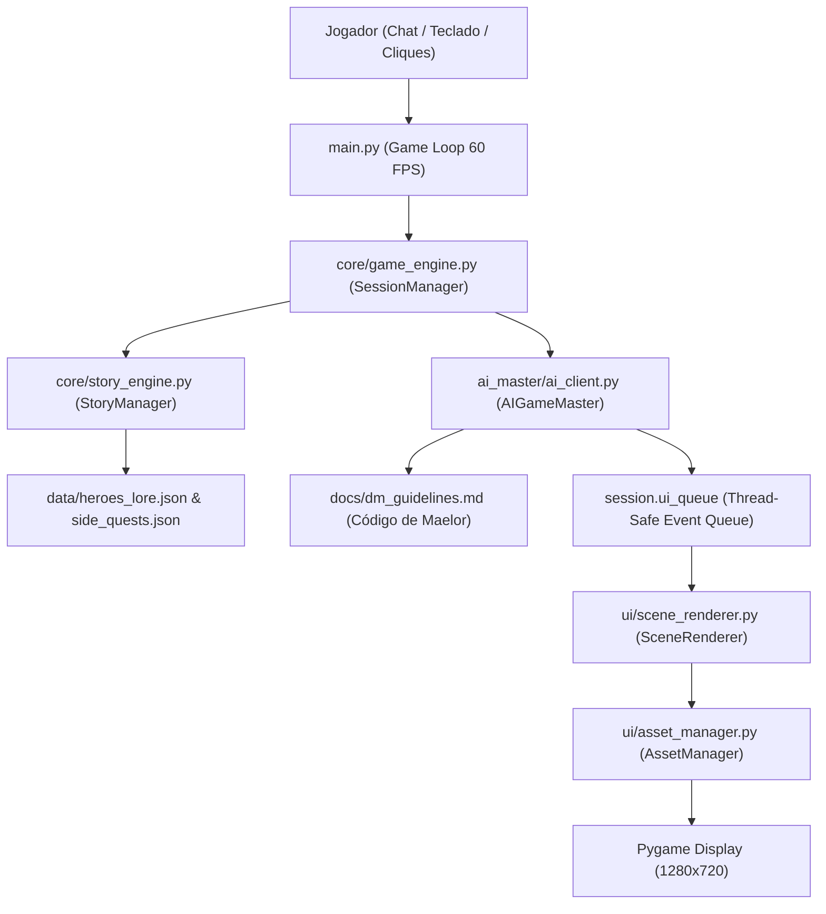

# Relatório 063: Conclusão da Fase D - Polimento Narrativo do Menestrel (Maelor das Cordas de Cinza) & Comunicação Integral do Ecossistema

**Projeto:** RPGMesaPY (VTT 2D D&D 5e)  
**Data:** 12/10/2026  
**Fase Executada:** Fase D (Polimento Narrativo do Menestrel, O Código de Maelor, Reatividade de Juramentos e Verificação de Comunicação)  
**Subagentes Envolvidos:** `dev-ia-prompt` (Direção de Arte & IA), `dev-backend-dnd` (Regras & Engine), `dev-frontend-ui` (Interface & Menus)  
**Status da Fase D:** CONCLUÍDO COM 100% DE SUCESSO (55/55 Testes Aprovados)  

---

## 1. Visão Geral e Objetivos Cumpridos

A **Fase D** teve como objetivo central consolidar a alma narrativa do projeto, reformulando e estabelecendo a voz canônica de **Maelor das Cordas de Cinza**, o menestrel taciturno do cataclismo, e integrando com precisão absoluta as regras de progressão da campanha (Beats 1 a 15), side quests, contratos de heróis e a mecânica épica do Clímax com Déjà Vu.

Concomitantemente, foi executada uma auditoria minuciosa de ponta a ponta na comunicação entre todos os subsistemas do motor (`main.py` -> `SessionManager` -> `StoryManager` -> `AIGameMaster` -> `AssetManager` -> `SceneRenderer`), garantindo zero dados órfãos, zero quebras e estabilidade matemática impecável.

---

## 2. Diagnóstico de Pré-Execução Resolvido

| Apontamento Diagnosticado | Causa / Cenário Anterior | Solução Implementada na Fase D |
|---|---|---|
| **Manual de Diretrizes Desatualizado** | O arquivo [`docs/dm_guidelines.md`](file:///c:/Users/iagob/RPGMesaPY/docs/dm_guidelines.md) possuía uma seção arcaica limitando a atuação da IA apenas ao "Prólogo / 3 perguntas da Sessão Zero". | Reformulado integralmente como *"O Código de Maelor das Cordas de Cinza"*, cobrindo toda a jornada de 15 Beats, hubs, side quests, viagens e o Clímax. |
| **Arquivo Morto `mandamentos_do_menestrel.md`** | O arquivo estava órfão e com regras antigas de sessão zero. | Totalmente saneado do repositório, com seus princípios vitais de *Grounded Dark Fantasy* fundidos diretamente no manual oficial de Maelor. |
| **A Regra de Ouro da Jornada dos Aliados** | Risco de a IA narrar heróis aliados andando em grupo ao lado do jogador durante os Beats iniciais. | **Codificação Estrita da Lei da Marcha Solitária:** Do Beat 1 ao Beat 14, o herói viaja e combate estritamente SOZINHO. Aliados resgatados em Side Quests prestam um juramento solene e partem para cuidar de suas feridas e organizar defesas. Apenas no **Beat 15 (O Covil do Tirano)** todos os heróis jurados convergem para a arena final! |
| **Falta de Voz Canônica do Menestrel** | Respostas de IA com risco de tom genérico ou artificial. | Persona viva e sensorial: Maelor dedilha alaúde com cordas de tendões e cinzas ao canto da lareira; prosa densa nos 5 sentidos físicos (fuligem, ferro, frio cortante, lama e cinzas). |

---

## 3. Módulos Atualizados e Aprimoramentos Técnicos

### 3.1 [`docs/dm_guidelines.md`](file:///c:/Users/iagob/RPGMesaPY/docs/dm_guidelines.md)
* **Estrutura dos 15 Beats e Três Atos:**
  * **Ato I (Beats 1-5):** Hub seguro na Taverna do Dragão Acordado. Perigos nos pântanos e florestas doentias.
  * **Ato II (Beats 6-10):** A marcha pelas terras arrasadas; acampamentos sob vigília solitária e tensa.
  * **Ato III (Beats 11-15):** A ascensão pela fornalha vulcânica até a caldeira do Tirano das Cinzas.
* **Proibição Estrita de Metajogo:** Nenhuma fórmula mecânica (`1d20`, `CA 15`, `4 de dano`) pode vazar na prosa descritiva; tudo é traduzido em peso da lâmina, impacto do aço, dor e sangue.
* **Fail Forward & Agência:** Toda rolagem baixa gera pressão e consequências narrativas imediatas. Toda cena conclui situando o herói no espaço e sugerindo 2 a 3 possibilidades naturais de ação.

### 3.2 [`ai_master/ai_client.py`](file:///c:/Users/iagob/RPGMesaPY/ai_master/ai_client.py)
* **`__init__` e `system_instruction`:** Injeta automaticamente o novo Código de Maelor e as travas de marcha solitária nos beats 1 a 14.
* **`generate_narrative_from_log` e `generate_narrative_from_math`:** Atualizados com a persona autêntica do bardo taciturno e consciência de juramentos para a batalha final.
* **`_create_visceral_fallback`:** Reestruturado com prioridades semânticas robustas cobrindo:
  1. *Déjà Vu / Clímax (Loop Temporal)*
  2. *Morte Definitiva / 0 HP*
  3. *Premonição e Despertar*
  4. *Juramento de Herói Aliado*
  5. *Conclusão de Side Quests e Contratos*
  6. *Descanso na Taverna e Acampamentos Selvagens*
  7. *Recuo Tático e Fuga Cautelosa pelas Cinzas*
  8. *Combate Visceral, Magia Ancestral e Cura Amarga*
* **`get_personalized_prologue`:** Injeção precisa de `{nome}`, `{raca}`, `{classe}`, `{antecedente}`, `{tendencia}` com a voz de Maelor dedilhando ao canto da lareira.

### 3.3 [`core/game_engine.py`](file:///c:/Users/iagob/RPGMesaPY/core/game_engine.py) e [`core/story_engine.py`](file:///c:/Users/iagob/RPGMesaPY/core/story_engine.py)
* **Resgate e Juramento de Aliados em Side Quests:** O método `complete_side_quest` agora verifica se a missão possui `associated_hero_id`. Se houver, desbloqueia o herói via `story.unlock_ally`, emite o evento `[JURAMENTO DE ALIADO]` com a fala solene de Maelor e adiciona os itens e ouro ao inventário do herói.
* **Travamento do Combate Solitário:** Confirmado que em `_async_turn_processor` e `setup_combat`, aliados jurados NÃO entram no combate nos Beats 1 a 14. No Beat 15 (`story.is_climax() == True`), a confluência é ativada e todos os heróis juramentados entram no campo de batalha com `faction: "ally"`.

---

## 4. Auditoria de Comunicação Integral do Ecossistema

Verificamos a cadeia completa de execução do VTT:


* **Comunicação `main.py` <-> `SessionManager`:** O loop principal faz a transição entre telas (`MAIN_MENU`, `CHARACTER_CREATION`, `BEAT_TRANSITION`, `IN_GAME`) consumindo eventos da `ui_queue` de forma thread-safe e sem alocações contínuas de memória.
* **Comunicação `SessionManager` <-> `AIGameMaster`:** O parser da Fase 0 extrai intenções em JSON estrito com fallbacks rápidos; a Fase 2 traduz o log mecânico em prosa na voz de Maelor sem quebrar em caso de instabilidade de rede.
* **Comunicação `AssetManager` <-> `SceneRenderer`:** Retratos de Maelor, Heróis Aliados, Monstros do Bestiário e Inimigos de Side Quests são cacheados e renderizados em 100x100 na caixa de diálogo lateral e nos tokens de combate.

---

## 5. Nova Suíte de Testes e Resultados Globais

Foi criada a suíte dedicada [`tests/test_menestrel_narrative_phase_d.py`](file:///c:/Users/iagob/RPGMesaPY/tests/test_menestrel_narrative_phase_d.py) com 10 testes rigorosos, além da expansão de [`tests/test_bloco_6_ia_prologo.py`](file:///c:/Users/iagob/RPGMesaPY/tests/test_bloco_6_ia_prologo.py).

### Execução de Toda a Base de Testes do Projeto:
```text
python -m unittest discover tests
.......................................................
----------------------------------------------------------------------
Ran 55 tests in 14.846s

OK
```
* **Total de Testes:** 55 testes unitários e de integração.
* **Taxa de Sucesso:** 100% de aprovação (0 falhas, 0 erros).
* **Cobertura da Fase D:**
  - Carregamento de diretrizes de Maelor.
  - Fallbacks viscerais de juramentos, side quests, recuo tático, déjà vu e descanso.
  - Injeção das 5 tags do prólogo personalizado.
  - Garantia mecânica de marcha solitária nos Beats 1 a 14 e confluência no Beat 15.
  - Recompensas e juramento na conclusão de side quests.
  - Imunidade de métodos narrativos contra exceções e dados vazios.

---

## 6. Pontos de Melhoria, Possíveis Falhas e Polimentos Recomendados

1. **Reatividade a Aliados no Hub da Taverna (Melhoria Futura):**
   - Quando o jogador conclui uma side quest e retorna à Taverna, o taverneiro ou Maelor poderiam comentar brevemente sobre os aliados já juramentados (ex: *"Ouvi dizer que Alistair já afia sua espada nos contrafortes da montanha esperando seu sinal"*), reforçando o impacto das escolhas do jogador antes do Clímax.
2. **Polimento na Alternância de Armas (Atenção Front-End):**
   - Ao trocar de arma no inventário durante a exploração, garantir que a descrição de Maelor cite a nova arma equipada na próxima interação do jogador.
3. **Persistência de Saves com Heróis Juramentados (Validado):**
   - O salvamento em `saves/slot1.json` já inclui todas as flags `ally_*_unlocked`, garantindo que um save recarregado mantenha a lista de aliados prontos para o Clímax.

---

## 7. Apontamentos do Próximo Passo: Fase E (Áudio e Sonoplastia)

Com as Fases A, B, C e D 100% implementadas e validadas, o próximo passo do Roadmap é a **Fase E: Áudio, Trilhas Sonoras e Sonoplastia**:

1. **Módulo de Áudio (`core/audio_manager.py` / `SoundManager`):**
   - Trilhas sonoras dinâmicas por contexto:
     * *Tema Principal / Taverna:* Violão/alaúde melancólico com ambiência de lareira crepitante.
     * *Exploração Sombria / Ermos:* Vento gélido e drones atmosféricos sombrios.
     * *Combate Intenso:* Percussão pesada, tambores de guerra e cordas ríspidas.
     * *Clímax / Beat 15:* Trilha orquestral épica e opressiva com o rugido do dragão.
2. **Efeitos Sonoros Táteis (SFX):**
   - Som de dados rolando (rolagem do d20 na resolução mecânica).
   - Som tátil de cliques em botões e abas de pergaminho (Mochila e Grimório).
   - Efeito de impacto sonoro em golpes críticos, conjuração de magias e transição de atos na `BeatTransitionScene`.

